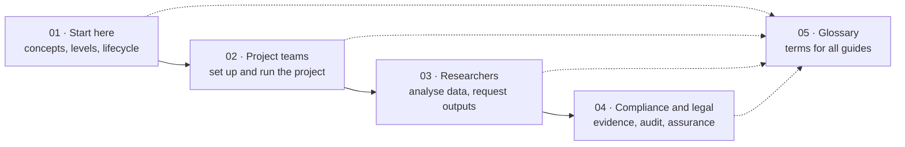

# The Nuvolos TRE 

Guides for the Nuvolos Trusted Research Environment (TRE): a governed project management toolkit for analysing sensitive data, where results leave only through a checked process.

## Start here

New to the TRE? Read
[01_start_here.md](01_start_here.md). It explains the Five Safes, the four
protection levels (Open L0, Controlled L1, Locked L2, Enhanced L3), the project
lifecycle (request → set up → import → work → output → operate → close out),
who does what, and what Nuvolos does not promise.

Then read the guide for your role:

| # | Guide | You are… | Answers |
| :---- | :--- | :--- | :--- |
| 01 | [01_start_here.md](01_start_here.md) | Any interested person curious about how Nuvolos deals with Trusted Research Environments (TREs) | What is a TRE? Why should I care? How does TRE experience differ from regular Nuvolos? |
| 02 | [02_for_project_teams.md](02_for_project_teams.md) | Project owner, project manager, data custodian, output checker, workspace/permissions operator | How do I set up the project, manage access, approve imports and outputs, handle budgets, change the level, close out? |
| 03 | [03_for_researchers.md](03_for_researchers.md) | Analyst or data scientist working in a project | How do I bring data in, run analysis at my level, request software, submit results, and get unblocked? |
| 04 | [04_for_compliance_and_legal.md](04_for_compliance_and_legal.md) | Compliance officer, DPO, legal reviewer, auditor | What evidence does the TRE produce, how are decisions recorded, who holds authority, what is not claimed? |

Keep [05_glossary.md](05_glossary.md) open alongside any guide: it defines
every term (agent, airlock, break-glass, data plane, protection level, …).
Status and evidence are per deployment — a definition does not mean a control
is available in yours.

## How the guides fit together

Each guide stands on its own — the numbers are the suggested reading order,
not prerequisites.

## Conventions

- Files are numbered `NN_snake_case.md` in suggested reading order.
